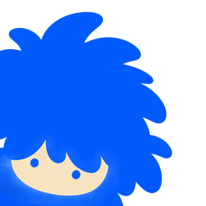
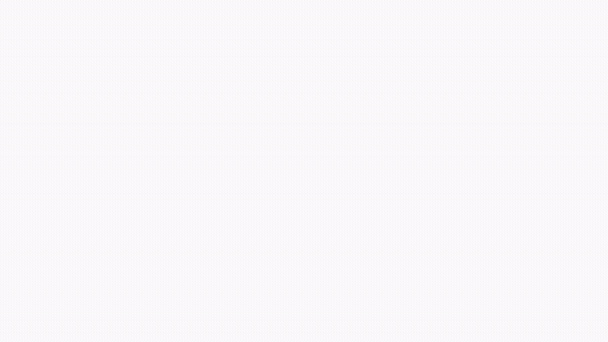
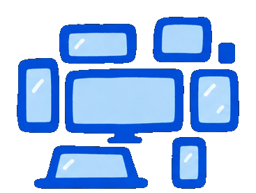
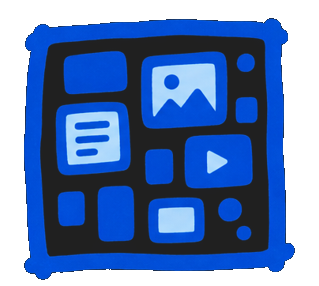
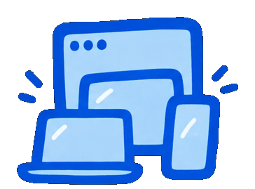

<p align="center">
  
</p>

<h1 align="center">Screen Stuff</h1>

<p align="center">
  <b>An infinite board that holds every screen you have,<br />
  and hands one rectangle of it to any call.</b>
</p>

<p align="center">
  <a href="https://selmanadam7-7.github.io/screen-stuff/"><b>Try it in your browser →</b></a>
  &nbsp;·&nbsp;
  <a href="https://github.com/selmanadam7-7/screen-stuff/releases/latest">Download for Windows</a>
</p>

<p align="center">
  Windows 10 1809+ &middot; 64-bit &middot; Tauri&nbsp;2 + Rust &middot; 3&nbsp;MB installer
</p>

<p align="center">
  
</p>

---

Every monitor, every window, every crop you care about becomes a live tile on a
Figma-style canvas. One rectangle on that canvas — the **stage** — is what the
call sees. Everything else is yours: you pan, zoom and rummage around your own
board while you talk, and nobody follows. No alt-tabbing, no restarting a share,
no "hold on, let me share a different screen".

<table>
<tr>
<td width="33%" align="center">
  <br />
  <b>Everything, at once</b><br />
  <sub>Four monitors, buried windows, a crop of one corner, your camera — all live tiles on one canvas.</sub>
</td>
<td width="33%" align="center">
  <br />
  <b>One rectangle is shared</b><br />
  <sub>The stage is what they see. The rest of the board is your private workspace, mid-call.</sub>
</td>
<td width="33%" align="center">
  <br />
  <b>Any app takes it</b><br />
  <sub>The board is an ordinary window. Discord, Meet, Zoom and Teams all share it, with audio.</sub>
</td>
</tr>
</table>

---

## Try it without installing anything

**[selmanadam7-7.github.io/screen-stuff](https://selmanadam7-7.github.io/screen-stuff/)**

That is the real cockpit, running in your browser, with drawn desktops instead
of your monitors. The same store, the same renderer, every keyboard shortcut.
Drag the blue rectangle, press `0`, press `T`. The only thing it cannot do is
capture your actual screens, which is what the download is for.

## Installing it

### Windows 10 1809 or newer, 64-bit

```powershell
winget install ScreenStuff
```

Or from a clone, which builds it if there is no release to fetch:

```powershell
powershell -ExecutionPolicy Bypass -File scripts\install.ps1
```

That takes the published installer if there is one and builds from source if
there is not, then checks the app is actually there rather than assuming. Add
`-CheckOnly` to see what it would do first. It installs per-user, needs no
administrator rights, and touches no drivers or system settings.

Or hand this repository to your coding agent and ask it to install Screen Stuff
-- [`AGENTS.md`](AGENTS.md) tells it everything it needs, including the failure
modes worth knowing about.

Releases are signed once a certificate is in place, and
[`packaging/winget`](packaging/winget) documents the one-time setup for both.
Until then a downloaded copy trips SmartScreen once: **More info**, then **Run
anyway**.

### macOS 13 Ventura or newer

```bash
pnpm install && pnpm tauri build
```

Capture goes through **ScreenCaptureKit**, which is the mirror of Windows
Graphics Capture: displays, windows, occluded windows and region crops all come
from the same API. Everything above it — the shared sessions, the resolution
ladder, the stage, the guest server — was already portable, so the macOS
backend is one file, [`src-tauri/src/capture_mac.rs`](src-tauri/src/capture_mac.rs),
plus a platform module in `sources.rs`.

macOS asks for **Screen Recording** permission the first time you add a screen,
in System Settings → Privacy & Security. There is no way to request it early and
no way to detect it beyond trying, so a refusal shows up as the error on the
tile.

Both platforms are compiled and linted on every push by
[`check.yml`](.github/workflows/check.yml) — the macOS backend was written on a
Windows machine, and a runner is the difference between "it compiles" and "I
believe it compiles". It found seven real errors the first time it actually
reached the code, which is the entire argument for having it.

Two macOS-specific notes. The region picker is a transparent full-screen window,
which on macOS needs Tauri's `macos-private-api` — that rules out the Mac App
Store, which was never the plan, since this ships directly like every other
broadcast tool. And the job pins its own Xcode: `screencapturekit` pulls in
`apple-metal`, whose Swift bridge uses Metal 4 types, so anything older than
Xcode 26 fails inside a dependency before reaching this project at all.

## Running it

```bash
pnpm install
pnpm app          # dev: cockpit + board, hot reloading
pnpm app:build    # release: writes an installer to src-tauri/target/release/bundle
```

Other useful scripts:

```bash
pnpm test         # frontend suite (vitest)
pnpm test:rust    # engine suite (cargo)
pnpm check        # typecheck + clippy, no warnings allowed
```

## How it looks

The interface is built from fifteen reference screenshots, with the palette
measured out of them rather than matched by eye — primary `#0562FE`, ink
`#1E2329`, borders `#DDDDE1`. Five looks ship (pure white, liquid glass, arctic
blue, graphite dark, spectrum pro) as token overrides, switchable in
**Settings → Look**. Icons are [Reicon](https://reicon.dev), mapped by meaning in
one file. Type is Inter, bundled rather than assumed.

The rules, the measurements and what was deliberately *not* faked from the
references are in [`docs/DESIGN.md`](docs/DESIGN.md).

## Two windows

**Cockpit** (`index.html`) — the control surface. The board's contents on the
left, canvas in the middle under a floating toolbar, inspector on the right,
scenes along the bottom. Everything you do happens here. Park it on a spare
monitor.

**Board** (`board.html`) — the output. No title bar, no chrome, no cursor. This
is the window you share in Discord, and the canvas whose pixels a camera or a
guest would receive. Nothing is ever drawn on it that the audience should not
see. Alt-drag moves it; the cockpit does the rest.

## What can go on the board

| Tile | What it is |
| --- | --- |
| **Display** | One of your monitors, live. |
| **Window** | One app window — captured even when it is buried behind everything else. |
| **Region** | A rectangle you drag on any screen. Shows one chart without the desktop around it. |
| **Camera** | Your webcam, croppable, circular or rectangular, mirrored or not. |
| **Image** | Paste a screenshot, or drag a file in. |
| **Web page** | A real browser window, parked off screen and captured — see below. |
| **Video** | A file, played on the board. |
| **Document** | A PDF, a page at a time. |
| **Note** | Text on coloured paper. |

Plus an ink layer — pen, highlighter, arrow, box, ellipse — that draws on top of
live feeds while they are still moving. Ink can be permanent or set to fade on
its own, for pointing at something mid-sentence.

## Keyboard

Local keys work while the cockpit has focus. Global keys (`Ctrl+Alt+…`) fire even
while you are typing in Discord.

| Key | |
| --- | --- |
| `0` | show the stage |
| `Shift+0` | fit everything in your view |
| `Ctrl+←` / `Ctrl+→` | back / forward through the views you have jumped to |
| `1`–`9` | jump to that scene |
| `G` | go private / come back |
| `Enter` | move the stage to your view |
| `F` | grab the window in front |
| `P H A B O` | pen, highlighter, arrow, box, ellipse |
| `Esc` | back to the pointer |
| `Space` + drag | pan the canvas |
| double-click | spotlight a tile |
| `←` `↑` `→` `↓` | nudge the selection, or the stage |
| `Ctrl+D` / `Ctrl+L` | duplicate / lock |
| `Ctrl+Z` / `Ctrl+Y` | undo / redo |
| `Ctrl+S` | save the stage as a scene |
| `Ctrl+Shift+S` | save the board |
| `Del` | remove selected |
| `Alt` + drag | move the board window |
| `Ctrl+Alt+B` | show or hide the board, from anywhere |
| `Ctrl+Alt+G` | go private, from anywhere |
| `Ctrl+Alt+Enter` | move the stage to your view, from anywhere |
| `Ctrl+Alt+0` | show the stage, from anywhere |
| `Ctrl+Alt+F` | grab the front window, from anywhere |
| `Ctrl+Alt+1`–`9` | scenes, from anywhere |

## The stage

The blue rectangle on the canvas is the stage. It is the only part of the board
anyone else ever sees, and it stays where you put it.

Everything outside it is private by default. Pan across to your notes, zoom into
a window to read it, drag in a new screen and park it off to one side — the call
keeps looking at the stage the whole time. That is the difference between a board
and a screen share: the board is bigger than the shot.

**Moving it.** Grab the stage by its edge or by the name tab above its corner and
drag. The eight handles resize it, always at the output shape. `Enter` moves it
to whatever you are looking at right now, and the inspector has exact numbers if
you want it lined up on a pixel. It is saved with the board, so it is where you
left it next time.

**Locking it.** Mid-call, one stray drag can re-aim the broadcast. **Lock against
dragging** stops the mouse moving it; scenes, `Enter` and the inspector still
work, because those are deliberate.

**Getting back.** Nothing in the app can take you somewhere you cannot leave.
`0` comes home to the stage from anywhere, `Ctrl+←` steps back through every jump
you have made, and the zoom pill has both as buttons. A hint appears when you
have wandered off, saying so and offering the way back.

**Following your work.** **Follow my work** on the scene rail points the stage at
whatever you are actually doing — the screen you are working on, or the window
you are working in. It settles before it commits, so alt-tabbing through five
windows is one move rather than five, and it ignores changes too small to be a
different shot. Two properties make it safe to leave on: it can only frame
something already on the board, so it can never reveal what you did not put
there; and touching the stage hands control straight back.

**Showing where you point.** Zoomed out to four monitors, a real cursor is about
two pixels in the output, which is why "it's right there" is the most repeated
sentence on any screen share. **Show my pointer** draws a ring where your cursor
is and a ripple when you click — on the output only, since you can already see
your own mouse.

**Punching in.** Hold `Z` and the stage flies to a tight shot around your
cursor, then back when you let go. It stays sharp rather than upscaling, because
the capture ladder re-requests resolution by on-screen size — which is the one
thing a normal screen share cannot do.

**Following your view, if you want it.** Turn on **Drag the audience with my
view** in Settings and the oldest behaviour returns: whatever you look at is
what they see. It is off by default because with it on there is no private area
at all.

**Going private.** **Go private** freezes the audience on the last shot while you
rearrange, then **Bring them here** moves the stage to where you now are.

In the cockpit everything outside the stage is dimmed and the stage is outlined
and named — so what is on air is never a guess.

## Preview and take

**Set up next** opens a second rectangle that nobody can see. Arrange the shot
in it — move it, resize it, rearrange tiles behind it — then **Take**, or press
`T`, and it goes on air. Taking swaps them, so the shot that was live becomes
the one queued behind, and cutting back and forth between two shots is one key
rather than a rebuild.

It is drawn in amber, never the accent, because the accent means live
everywhere else in the app and the whole point of this rectangle is that it is
not.

This is what the private board was always for.

## Arranging

**Director → Even grid / Two up / Focus and strip / Picture in picture.** A grid
says everything on screen matters equally, which is almost never true — usually
one thing is what you are talking about and the rest is context.

The first tile selected is the hero in every layout that has a hierarchy, so
"make this the big one" is "select it first" and there is no extra concept to
learn. Nothing here is a mode: the tiles stay tiles, and you can nudge any of
them afterwards without it snapping back.

## Holding the shot

**Hold the shot** on the scene rail covers the stage with a card — starting
soon, back in a minute, taking a break, thanks for watching — with a live
countdown where one makes sense. Every call needs this and nobody has one to
hand, so people improvise with a Notes window at 400% and their desktop visible
around the edges.

The deadline is stored as a wall-clock time rather than a duration, because it
has to mean the same thing in the cockpit, in the board window and in a guest's
browser, and each of those has a different `performance.now()` origin.

A card is a live decision, not a property of the board: reopening a board that
was saved with "back in a minute" up does not put you back behind it.

**Your name on the shot** puts a banner in the corner with your name and what
you do, sized as a proportion of the stage so it looks the same on a punched-in
shot as on the whole board.

## Keeping your face in the shot

Auto-framing follows your work between screens. Without this, your camera does
not: it sits where you parked it, and you end up on a call where your face is
visible only while you happen to be working on the monitor it was left on.

**Director → Keep my camera in the corner** pins it. A pinned tile has no fixed
place on the board — its box is derived from wherever the stage is, every frame,
so it rides along through auto-framing, scenes, punch-ins, takes and a drag of
the stage handles.

Derived rather than written back, and that is the whole design. Storing the new
position on every stage change would fill the undo stack with camera moves
nobody made, and during a fly the camera would jump to the destination while the
shot was still travelling. Computing it from the *animated* frame means it flies
with the shot.

Any tile can be pinned, not just the camera — corner, size and inset are in the
inspector. A pinned tile shows corner brackets rather than resize handles,
because its size is a fraction of the shot rather than a rectangle on the board.
Drag it to another corner and it re-pins there.

## A camera that knows when you are talking

**Grow while I talk**, on a camera tile. When you speak, the camera grows; when
you go quiet and start typing, it settles back and the screen takes over. On a
normal call the camera is a fixed box whether you are mid-sentence or silently
reading a stack trace, and a human director would never do that.

The whole difficulty is hysteresis. Speech has gaps between words and pauses
between sentences, so a gate that follows the level directly pumps several times
a second and is unwatchable. It opens in 140 ms, because being late to your own
sentence looks broken, and takes 1.4 s of real quiet to let go, because a pause
is not the end of talking.

**What it does with the microphone:** opens it only while the switch is on,
reads one number — how loud — about thirty times a second, and closes it the
moment you turn it off. Nothing is recorded, stored or sent; the audio never
leaves the Web Audio graph. The size itself is runtime state and never touches
the document, because the undo stack is not a transcript.

## Going back

"Wait, go back to that" happens on every call, and the usual answer is twenty
seconds of finding your way to a window you have since closed. **Remember the
last 45 seconds** in Settings keeps the shot in a ring, and a scrubber appears
over the canvas when there is something to go back to. Scrubbing shows the
remembered frame to the audience too — the point is "let me show you that
again", so a private rewind would be the wrong feature.

**It is not a recording, and the difference is the design.** It lives in memory
and never touches the disk. It is a fixed-length ring, so the oldest second
falls off the end continuously and there is never a growing pile of your screen
anywhere. It ends when the app does: nothing to find later, nothing to leak, no
file to forget about. About 15 MB, and the ceiling does not move however fast
the machine feeds it.

## Audio, honestly

A webcam is a video-only device. When an app asks Windows for "the camera" it
gets picture and nothing else — so in camera mode, a video playing on your board
is seen and not heard. That is true of every app, not just this one.

There are exactly three ways sound reaches the other person: your microphone,
a screen share (which carries the shared app's own audio), or a virtual audio
device — a real driver install.

So Screen Stuff leans on share mode when sound matters. Share the board window and
the audio of anything playing on it travels with it. On Discord you can run both
at once: camera mode carrying the board, plus a screen share of the same window
carrying the sound.

## Web tiles

A web tile is not an iframe. An iframe cannot be composited into the output
canvas, so web tiles would vanish in camera mode and for guests. Instead each one
is a real browser window that Screen Stuff owns, parked off screen and captured
like any other window — so it behaves exactly like a monitor tile everywhere it
matters. **Click in it** brings the page forward for a moment so you can interact,
then parks it again. Same trade OBS makes.

## Guest links

A guest opens a link and sees the board in their browser. They get the board
*document* and subscribe to the same source streams, then run the same renderer
the cockpit does -- so they can look around on their own, draw, and drop a file
in, without any of that costing you a second encode.

The security boundary: a guest may only open sources the published board
actually uses. Take a tile off the board and their access to it stops in the
same breath.

### How far the link reaches

Two choices, and the Share dialog makes you pick rather than burying it:

**This network only** (the default). The guest server listens on this machine.
Anyone on the same wifi can open the link; nobody else can reach it at all.

**Anywhere.** Opens a public `https://….trycloudflare.com` address that
forwards to that same loopback port. `cloudflared` dials *out* to Cloudflare, so
it needs no port forwarding, no static address and no router conversation -- it
works from a hotel, an office network, or behind CGNAT. No account and no
payment either.

The helper binary is fetched once, on the first use, into
`%APPDATA%\screen-stuff\cloudflared.exe`, and only over HTTPS from Cloudflare's
own repository. It is about 40 MB, which is why it is not in the 2.6 MB
installer.

What that costs, said plainly:

- The guest server is reachable from the internet while the tunnel is up. The
  16-character token in the link is what keeps strangers out -- treat the link
  like a password. Closing the guest link takes the public address down with it.
- The address is random and changes every session, so yesterday's link is dead.
  Good for security, mildly annoying for a recurring meeting.
- Frames pass through Cloudflare. They are JPEG over TLS, but not end-to-end
  encrypted, and someone else's machine is carrying them. If that matters for a
  particular call, stay on the local option.

## Into any call, as a camera

Share hands out a second link alongside the guest one: the **output link**, at
`/o/<token>`. Same board, none of the furniture — no toolbar, no names, no
cursors, no reconnecting notice. A camera does not have a user interface.

Add a **Browser** source in OBS, Streamlabs, vMix or Ecamm, paste it, set it to
1920 × 1080, and start that tool's virtual camera. Screen Stuff is then a webcam
in Discord, Meet, Zoom, Teams and anywhere else that takes one — with nothing
installed, nothing registered, and no administrator anywhere in the story.

The letterboxing is drawn rather than laid out, and it is the part that matters.
A guest window of the wrong shape shows *more board*, which is right for someone
looking around. An output of the wrong shape must show exactly the stage and
black bars, because the alternative is quietly broadcasting the private half of
the board to everyone on the call. `scripts/check-output.mjs` loads the real page
at four shapes and samples the pixels to prove it.

An output view is a feed and not a person: it never draws, never roams whatever
the host has granted, and does not appear in the guest list, so "2 watching"
never means "one guest and OBS".

## Everyone else in the room

A guest can already draw on the board, which is the heavyweight way to point at
something. Most of the time nobody wants to leave a mark — they want to say
"that line", or "yes", and have it gone a moment later.

So every guest gets a **named cursor** on the board, and a row of six
**reactions** that float up and fade. Both are ephemeral by construction:
nothing here ever enters the document, so none of it can end up in a saved
board, in the undo stack, or on the audience's screen by accident.

Reactions are a closed list, checked on the server. A guest is a stranger
holding a link, and whatever they send is drawn on the host's board.
`scripts/check-presence.mjs` sends a running server every reaction that is on
the list, several that are not, and a couple of malformed messages, and checks
the connection is still standing afterwards.

Cursor colours come from hashing the name, so the same person is the same colour
twice, on every machine.

## Driving it from something else

Whoever is running this has both hands busy — they are presenting. So everything
the operator can do is available to anything else on the machine: a Stream Deck,
a script, the hotkey daemon they already live in.

Turn it on in **Settings → Other software on this machine**. It is off until you
do, because a control surface that appears by itself is a surprise, and this one
can move what an audience sees.

```bash
curl -X POST "http://127.0.0.1:4488/stage" \
  -H "X-Control-Token: YOUR_TOKEN" \
  -H "content-type: application/json" \
  -d '{"tile":"Code"}'
```

```
GET  /            every action, generated from the table that runs them
GET  /state       what is on air right now
GET  /sources     screens and windows you could add
GET  /shot        a PNG of the shot, from the renderer the audience is watching
GET  /events      a WebSocket: state, every time it changes
POST /<action>    stage, layout, scene, card, tile, add, take, punch, guests, …
```

Three things shape it. **Answers say what happened** — the stage it actually
landed on, the tile it actually found — because a caller who gets `{ok: true}`
cannot tell a working button from a broken one. **Refusals are sentences**: ask
for a tile that is not there and you get the names of the ones that are.
**Things are addressed the way a person would** — `{"tile": "code"}` finds the
tile labelled Code — and two matches is a refusal rather than a guess, because
cutting to the wrong thing mid-call is worse than doing nothing.

It listens on `127.0.0.1` only; the guest server and the tunnel have no route
into it. Every request needs the token, and any request carrying an `Origin`
header is refused outright — curl, Python, Node and a Stream Deck plugin send no
such header, and a web page cannot avoid sending one, so a page that somehow
learned your token still cannot drive your app.

[`packaging/control`](packaging/control) has the wrapper that reads the token
out of your own settings so nothing has to be pasted into a Stream Deck button,
plus the six buttons worth binding first.

## Boards

Boards save whole — layout, tiles, ink, scenes, hotkeys — as JSON under
`%APPDATA%\screen-stuff\boards`. Save one as a **template** to spawn pre-arranged
boards for a call type. A board that already has a file autosaves a few seconds
after you stop making changes; an unnamed scratch board stays unsaved until you
decide it is worth keeping.

Nothing is recorded. The call is the call.

## How it fits together

```
WGC capture ──▶ scale + JPEG ──▶ WebSocket ──▶ decode ──▶ one canvas ──▶ share / camera / guests
 (one per source)   (one per tile)   (loopback)
```

- **`src-tauri/src/capture.rs`** — Windows Graphics Capture sessions, a lossy
  single-slot frame mailbox, a buffer pool, and one encode worker per rendition.
  Several tiles on the same source share one capture.
- **`src-tauri/src/server.rs`** — a loopback WebSocket, token-gated, serving
  frames as binary and control as JSON.
- **`src/core/render.ts`** — the compositor. One function draws the board, and it
  is called twice: by the board window with no chrome, and by the cockpit with
  selection, handles, guides and the frame outline. Sharing the draw path is what
  guarantees the cockpit is telling the truth.
- **`src/cockpit/store.ts`** — the document lives here. The board window is a
  renderer that receives snapshots, which is what lets the thing you edit and the
  thing on air be deliberately different.

A tile that is small on screen asks for fewer pixels; a tile that is spotlit asks
for more. An unwatched source stops capturing entirely.

## Performance

Measured on an RTX 5070 / i7-14700F, four 1440p displays:

| | |
| --- | --- |
| Scale + encode, 1440p → thumbnail | **3.3 ms** release, 4.6 ms dev |
| Four live displays + note + ink, composited | 60 fps at 1920×1080 |

Two notes for anyone changing the encode path:

- Dependencies build optimised even in dev (`[profile.dev.package."*"]`), **and so
  does this crate** (`[profile.dev] opt-level = 1`) — the resize and encode entry
  points are generic, so their bodies monomorphise into this crate and compile at
  *its* opt-level. At `0` a single thumbnail frame took 434 ms.
- Crop and scale happen in one pass over an immutable view of the frame. The
  obvious version copies the frame two or three times, which at 1440p is ~30 MB
  of memory traffic before any real work starts.

## Security

The frame server binds to `127.0.0.1` on an ephemeral port behind a token
generated fresh on every launch, and the token is checked before the WebSocket
upgrade is even considered. Without that, a web page that guessed the port could
read every screen you own.

Debug builds log the full stream URL so the cockpit can be opened in a browser
against a running engine. Release builds never do.

The control API is a second door and is treated as one: off until switched on,
loopback only, its own token, and closed to anything sending an `Origin` header.
Its token is deliberately *not* regenerated per launch — a Stream Deck button
that stops working every morning is not a Stream Deck button — so it is stored
in settings and can be rolled from the same panel that shows it.

## Development tools

```bash
node scripts/probe-frame.mjs <ws-url> <out-dir> monitor:1 window:1234   # pull one frame from each source
node scripts/probe-stats.mjs <ws-url> [samples] [gap-ms]                # watch the engine's counters
node scripts/check-board.mjs <ws-url> out.png                           # end-to-end render check
node scripts/shoot.mjs <url> out.png                                    # screenshot the cockpit
node scripts/check-stage.mjs [base-url]                                 # drive the stage in a real browser
node scripts/check-layout.mjs [base-url]                                # measure the shell at five widths
node scripts/check-tunnel.mjs                                           # prove off-network sharing really works
node scripts/check-output.mjs <output-url>                              # the output view at four window shapes
node scripts/shoot-stage.mjs <out-dir> [base-url]                       # the stage in every state
node scripts/make-icons.mjs                                             # redraw the app icon
```

The stream URL is printed by `pnpm app` on startup in debug builds.

## Not built yet

Screen Stuff does not register itself in Windows' own camera list. The route for
that is `MFCreateVirtualCamera`, and it requires a COM media source registered
under `HKLM` and loaded into the Windows Frame Server service as LOCAL SERVICE —
an elevated install step, and a component whose crash degrades the camera stack
for every application on the machine. That is the category of system surgery this
project set out to avoid, so it uses the output link above instead, which reaches
the same place with nothing installed.

See [`docs/ROADMAP.md`](docs/ROADMAP.md) for the rest of the gaps.

## Brand

Everything visual lives in [`assets/brand`](assets/brand), and the app reads it
from there rather than keeping its own copy:

| | |
| --- | --- |
| [`icon/`](assets/brand/icon) | The face of Screen Stuff. `scripts/make-icons.mjs` copies it into the Tauri bundle and the web pages, so the taskbar, the installer and every browser tab show the same one. |
| [`logo/`](assets/brand/logo) | The mark, in blue, white and black, plus `logo-current.svg` which draws in `currentColor`. `scripts/make-brand-component.mjs` turns that one into `src/ui/Brand.tsx`, which is the mark you see in the title bar and on the guest page. |
| [`illustrations/`](assets/brand/illustrations) | The drawings above. |

Both scripts only ever copy or transcribe. Nothing redraws the icon, because a
redrawn icon is one that drifts away from the brand folder without anyone
noticing.

```bash
node scripts/make-icons.mjs            # brand -> app icons and favicons
node scripts/make-brand-component.mjs  # logo SVG -> the React mark
```

## Tests

```
cargo test    74 passing   engine, feeds, protocol, sources, store, guests, tunnel
vitest       326 passing   geometry, document, stage, auto-framing, redaction, pointer, overlays, layouts, voice, replay, resize, wire, render, frames, design
```

Plus harnesses that exercise the real thing rather than a mock: `probe-frame`
pulls a frame from every source, `check-board` renders a full board against the
live engine, `check-guest` joins a guest link and verifies the security gate,
`check-camera-feed` proves the host's camera reaches a guest, `check-stage` drags
the stage around a running cockpit and checks that no control leaves you
stranded, `check-layout` measures the shell at five window widths, `shoot-system`
and `shoot-stage` capture every look, page, modal and stage state in one pass,
and `guest_harness` stands the whole guest path up without the app shell.
