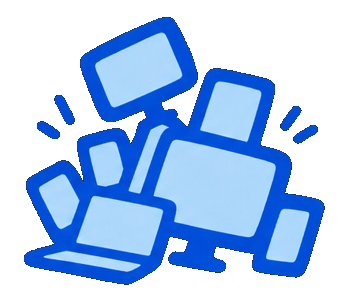
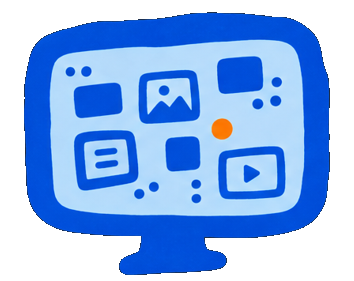
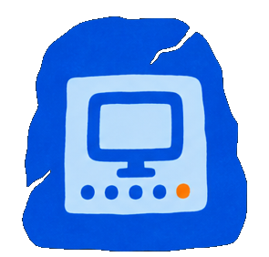

  

<h1 align="center">Screen Stuff brand</h1>

Every visual the app and this repository use, in one place.

---

## The icon

The face of Screen Stuff. This is what appears in the taskbar, the Start Menu,
the installer, the uninstall entry and every browser tab.

  
  &nbsp;&nbsp;
  
  &nbsp;&nbsp;
  
  &nbsp;&nbsp;
  

`screen-stuff-{16,32,48,64,128,256,512}.png` are transparent;
`screen-stuff-1024.png` and `screen-stuff-arctic-1024.png` are the full-size
exports, transparent and on the arctic ground. `icon.ico` carries every size
Windows asks for in one file.

Run `node scripts/make-icons.mjs` after changing any of them. It copies — it
never redraws — so what ships is exactly what is in this folder.

## The mark

  

A sack of screens. Used small, in the app's title bar and at the top of the
guest page, where it has to read at 16–20px.

| File | For |
| --- | --- |
| `logo-current.svg` | **The one the app uses.** Draws in `currentColor`, so it takes the ink of whatever it sits in and is right in all five looks. |
| `logo-blue.svg` / `.png` | Brand blue, `#004DD4`, on transparency. |
| `logo-white.svg` / `.png` | For dark grounds. |
| `logo-black.svg` / `.png` | For anywhere colour would be wrong. |
| `logo-blue-on-white.svg` | The screen filled white rather than cut out — for busy backgrounds. |
| `logo-white-on-black.svg`, `logo-black-on-white.svg` | The same idea, inverted. |

`node scripts/make-brand-component.mjs` turns `logo-current.svg` into
`src/ui/Brand.tsx`. Edit the SVG, never the generated component.

## Illustrations

<table>
<tr>
<td align="center" width="33%"> <code>screen-wall</code></td>
<td align="center" width="33%"> <code>screen-pile</code></td>
<td align="center" width="33%"> <code>device-stack</code></td>
</tr>
<tr>
<td align="center"> <code>one-board</code></td>
<td align="center"> <code>board-glyph</code></td>
<td align="center"> <code>stone-screen</code></td>
</tr>
</table>

Transparent PNGs, so they sit on any ground. They are documentation art — the
app itself ships no raster illustrations, because everything in the interface is
either the mark, a Reicon glyph, or drawn on the canvas.

## Colour

The interface palette was measured out of the reference screenshots rather than
matched by eye; the full set and the reasoning are in
[`docs/DESIGN.md`](../../docs/DESIGN.md). The two that matter here:

| | | |
| --- | --- | --- |
| Brand blue | `#004DD4` | The mark, as drawn. |
| Interface accent | `#0562FE` | What the app actually paints the mark in, so it matches every other live thing on screen. |

They are deliberately not the same value. The mark was drawn for print and
export; the interface accent came out of the references and is the colour of
"this is yours to press" everywhere else in the app.
